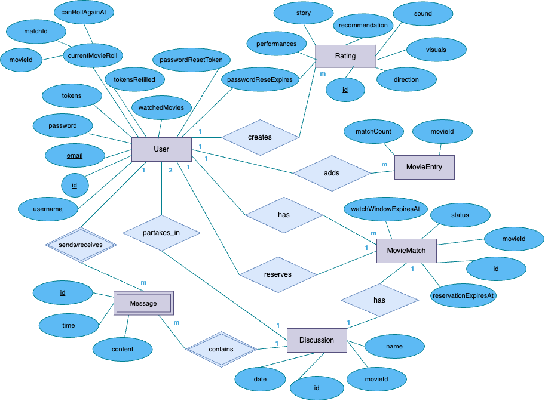
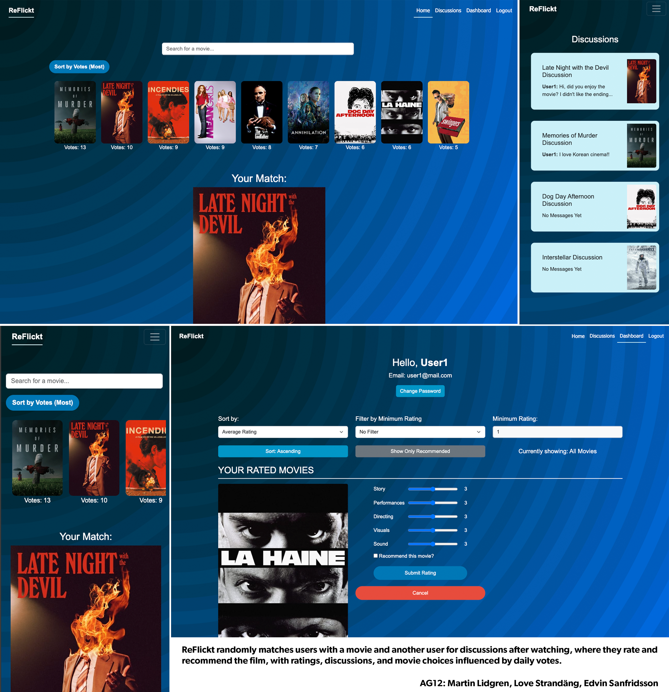

# Backend and Frontend Template

Latest version: https://git.chalmers.se/courses/dit342/group-00-web

This template refers to itself as `group-00-web`. In your project, use your group number in place of `00`.

## Project Structure

| File        | Purpose           | What you do?  |
| ------------- | ------------- | ----- |
| `server/` | Backend server code | All your server code |
| [server/README.md](server/README.md) | Everything about the server | **READ ME** carefully! |
| `client/` | Frontend client code | All your client code |
| [client/README.md](client/README.md) | Everything about the client | **READ ME** carefully! |
| [docs/LOCAL_DEPLOYMENT.md](docs/LOCAL_DEPLOYMENT.md) | Local production deployment | Deploy your app local in production mode |

## Requirements

The version numbers in brackets indicate the tested versions but feel free to use more recent versions.
You can also use alternative tools if you know how to configure them (e.g., Firefox instead of Chrome).

* [Git](https://git-scm.com/) (v2) => [installation instructions](https://www.atlassian.com/git/tutorials/install-git)
  * [Add your Git username and set your email](https://docs.gitlab.com/ce/gitlab-basics/start-using-git.html#add-your-git-username-and-set-your-email)
    * `git config --global user.name "YOUR_USERNAME"` => check `git config --global user.name`
    * `git config --global user.email "email@example.com"` => check `git config --global user.email`
  * > **Windows users**: We recommend to use the [Git Bash](https://www.atlassian.com/git/tutorials/git-bash) shell from your Git installation or the Bash shell from the [Windows Subsystem for Linux](https://docs.microsoft.com/en-us/windows/wsl/install-win10) to run all shell commands for this project.
* [Chalmers GitLab](https://git.chalmers.se/) => Login with your **Chalmers CID** choosing "Sign in with" **Chalmers Login**. (contact [support@chalmers.se](mailto:support@chalmers.se) if you don't have one)
  * DIT342 course group: https://git.chalmers.se/courses/dit342
  * [Setup SSH key with Gitlab](https://docs.gitlab.com/ee/ssh/)
    * Create an SSH key pair `ssh-keygen -t ed25519 -C "email@example.com"` (skip if you already have one)
    * Add your public SSH key to your Gitlab profile under https://git.chalmers.se/profile/keys
    * Make sure the email you use to commit is registered under https://git.chalmers.se/profile/emails
  * Checkout the [Backend-Frontend](https://git.chalmers.se/courses/dit342/group-00-web) template `git clone git@git.chalmers.se:courses/dit342/group-00-web.git`
* [Server Requirements](./server/README.md#Requirements)
* [Client Requirements](./client/README.md#Requirements)

## Getting started

```bash
# Clone repository
git clone git@git.chalmers.se:courses/dit342/group-00-web.git

# Change into the directory
cd group-00-web

# Setup backend
cd server && npm install
npm run dev

# Setup frontend
cd client && npm install
npm run serve
```

> Check out the detailed instructions for [backend](./server/README.md) and [frontend](./client/README.md).

## Visual Studio Code (VSCode)

Open the `server` and `client` in separate VSCode workspaces or open the combined [backend-frontend.code-workspace](./backend-frontend.code-workspace). Otherwise, workspace-specific settings don't work properly.

## System Definition (MS0)

### ReFlickt

#### Purpose

ReFlickt matches users randomly from a pool of movies, and once they have watched it, they’re invited to join discussions with another user who was matched with the same film. Here they can share thoughts and debate plot twists —all while discovering new films and making new friends. </br> Users are prompted to rate certain aspects of the film after seeing it and choose to recommend the movie or not, which acts as talking points for the discussion participants. The ratings and discussions are saved and always accessible to users. The pool of movies can be influenced by voting on it with vote tokens received every 24 hours.

#### Advanced Feature Description
The advanced feature of our project is the seamless integration of The Movie Database (TMDb) API, allowing our application to search for movie titles and retrieve comprehensive movie details using a movie ID. This includes accessing essential information like movie summaries, actor and director details, and their respective images. By leveraging TMDb's robust and regularly updated database, we eliminate the need to store or maintain this data within our own application, streamlining both storage and upkeep. This feature is implemented full-stack, from the backend service to frontend display, ensuring dynamic, up-to-date content for users.

### Pages

* **Log-in Page:** First page you are met by when you enter the application and are not signed in. Here you can enter your credentials to log in and end up on the Home page or sign up to end om on the Register page.
* **Register Page:** Here you create an account with a unique email and username.
* **Home page:** Here you can see what movies are in the pool, roll for a movie match and see your current match.
* **Chat Page:** The chat room for a certain movie involving two users, that is creating after rating a movie you have been matched with.
* **Dashboard Page:** Contains user ratings and actions, like changing password. 
* **Movie Page:** You can search for a movie on the home page or click any poster to navigate here, displaying information for said movie. Here you can also add it to the random pool of movies spending tokens.

### Entity-Relationship (ER) Diagram



## Teaser (MS3)


